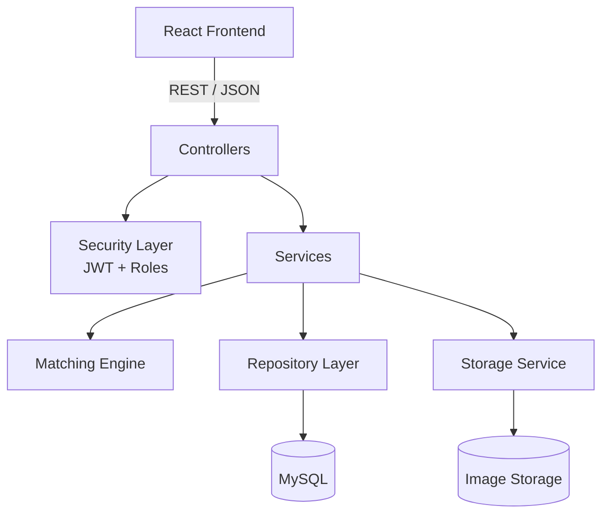
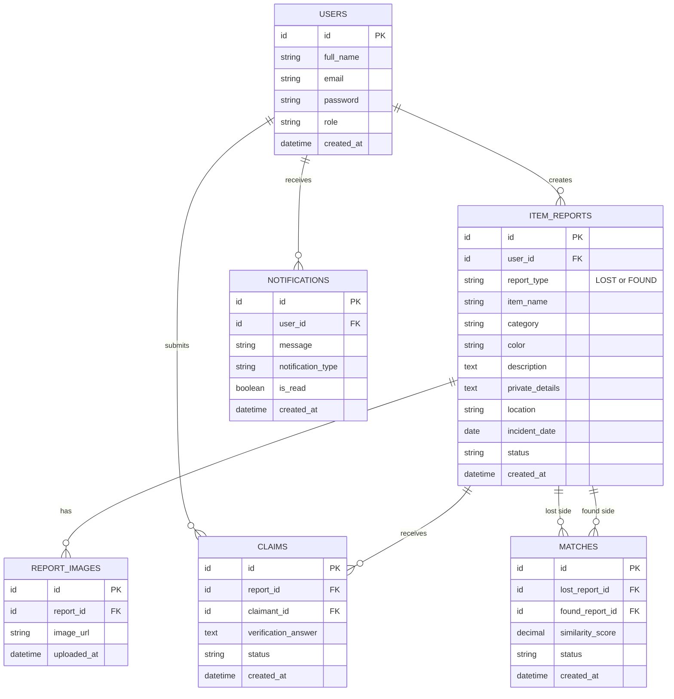

<div align="center">

# Retrace

**Find what's lost. Return what's found.**

A community-driven Lost & Found platform that matches lost and found reports, verifies ownership privately, and tracks every recovery.


</div>

---

## Table of Contents

- [Overview](#overview)
- [Problem Statement](#problem-statement)
- [Key Features](#key-features)
- [User Roles](#user-roles)
- [How Matching Works](#how-matching-works)
- [Tech Stack](#tech-stack)
- [Architecture](#architecture)
- [Database Design](#database-design)
- [API Reference](#api-reference)
- [Security and Business Rules](#security-and-business-rules)
- [Getting Started](#getting-started)
- [Testing](#testing)
- [Roadmap](#roadmap)
- [Future Enhancements](#future-enhancements)
- [Project Goals](#project-goals)
- [Contributing](#contributing)
- [License](#license)

---

## Overview

Retrace connects people who have **lost** an item with people who have **found** one. Instead of scattered WhatsApp groups, social media posts and reception desks, everything lives in one searchable system. A scoring algorithm suggests likely LOST/FOUND pairs, and a private claim process confirms real ownership before handover.

**Target communities:** college campuses, libraries, offices and other shared spaces.

> An item that is lost should have a better chance of finding its way home.

---

## Problem Statement

People lose belongings in colleges, libraries, offices, public transport, restaurants and other public spaces. Today they rely on word of mouth and group chats, which causes:

- Lost and found information spread across many platforms
- Old reports that become impossible to find
- No central search
- No easy way to match a lost report with a found one
- Informal, unreliable ownership checks
- No record of successful recoveries

Retrace replaces this with one centralized, searchable and organized platform.

---

## Key Features

| Area | What it does |
|---|---|
| **Authentication** | Registration, login, hashed passwords, JWT sessions, role-based access, profile management |
| **Reporting** | Create `LOST` or `FOUND` reports with name, category, colour, description, date, location, photos and private identifying details |
| **Search & Discovery** | Filter by name, category, type, location, date and status, with sorting and pagination |
| **Matching Engine** | Weighted similarity scoring ranks likely LOST/FOUND pairs |
| **Claims & Verification** | Submit claims, answer private verification questions, approve or reject, confirm handover |
| **Notifications** | Alerts for matches, new claims, claim decisions, status changes and recoveries |
| **Image Management** | Photo uploads with file validation and access restrictions; references stored separately from reports |
| **Admin Tools** | Moderate reports, manage users, investigate misuse, view platform statistics |

---

## User Roles

### User
- Register, log in and manage a profile
- Report lost and found items, with photos
- Browse and search all reports
- View potential matches
- Submit ownership claims
- Respond to claims on their own FOUND reports
- Track report and claim status
- Receive notifications

One account can act as both the person who lost an item and the person who found one.

### Administrator
- Monitor platform activity and statistics
- Review and remove inappropriate or fraudulent reports
- Manage user accounts
- Investigate reported misuse

---

## How Matching Works

Every LOST report is compared against FOUND reports (and vice versa) using a weighted score:

```
S = (0.25 × C) + (0.30 × D) + (0.25 × L) + (0.20 × T)
```

| Symbol | Attribute | Weight |
|:---:|---|---:|
| C | Category similarity | 25% |
| D | Description similarity (Jaccard) | 30% |
| L | Location similarity | 25% |
| T | Date similarity | 20% |

**Description similarity** uses Jaccard similarity on the word sets of both descriptions:

```
J(A, B) = |A ∩ B| / |A ∪ B|
```

**Score interpretation** (each component is scaled to 0–100):

| Score | Result |
|---|---|
| 80–100 | Strong potential match |
| 60–79 | Possible match |
| Below 60 | No suggestion |

Matches are ranked by score. Weights and thresholds are initial values and will be tuned using test data.

> **Important:** A high score means a *potential* match, never confirmed ownership. Ownership is only confirmed through the claim and verification process.

---

## Tech Stack

| Component | Technology |
|---|---|
| Language | Java 25 |
| Backend | Spring Boot, REST APIs |
| Security | Spring Security, JWT |
| Database | MySQL |
| ORM | Spring Data JPA |
| Validation | Jakarta Validation |
| Frontend | React, Tailwind CSS / CSS |
| Build Tool | Maven |
| Testing | JUnit 5, Mockito, Postman |
| API Docs | Springdoc OpenAPI |
| Version Control | Git, GitHub |

---

## Architecture



| Layer | Responsibility |
|---|---|
| Controller | Handles HTTP requests and responses |
| Service | Business logic |
| Repository | Database access |
| Entity | Database records |
| DTO | Request and response shapes |
| Mapper | Entity ↔ DTO conversion |
| Security | Authentication and authorization |
| Exception Handler | Consistent error responses |

---

## Database Design



- `matches` has a **unique constraint** on `(lost_report_id, found_report_id)` to prevent duplicate pairs.
- `private_details` is never returned by public endpoints.
- The schema will evolve as features are implemented.

---

## API Reference

Base path: `/api`. Interactive docs will be available via Springdoc OpenAPI (Swagger UI) once the backend is running.

### Auth
| Method | Endpoint | Description |
|---|---|---|
| POST | `/api/auth/register` | Register a user |
| POST | `/api/auth/login` | Authenticate and receive a JWT |

### Reports
| Method | Endpoint | Description |
|---|---|---|
| POST | `/api/reports` | Create a report |
| GET | `/api/reports` | List and search reports |
| GET | `/api/reports/{id}` | Get report details |
| PUT | `/api/reports/{id}` | Update a report |
| DELETE | `/api/reports/{id}` | Withdraw a report |
| GET | `/api/reports/my` | Get the current user's reports |

### Matches, Claims and Notifications
| Method | Endpoint | Description |
|---|---|---|
| GET | `/api/matches` | Get potential matches |
| POST | `/api/reports/{id}/claims` | Submit an ownership claim |
| GET | `/api/claims` | Get the current user's claims |
| PATCH | `/api/claims/{id}/decision` | Approve or reject a claim |
| GET | `/api/notifications` | Get notifications |
| PATCH | `/api/notifications/{id}/read` | Mark a notification as read |

> This is the planned API contract and may change during implementation.

---

## Security and Business Rules

- Passwords are securely hashed
- Users can only modify their own reports
- Users cannot claim their own FOUND reports
- Private identifying details are never exposed publicly
- Admin functionality is restricted to administrators
- Uploaded files are validated (type and size)
- Invalid report and claim status transitions are rejected
- Duplicate matches are prevented
- Every sensitive operation is authorized on the backend, not just the UI

---

## Getting Started

> The project is in the planning stage, so these steps describe the intended setup and will be finalized as code lands.

### Prerequisites

- Java 21
- Maven 3.9+
- MySQL 8+
- Node.js 18+ and npm

### 1. Clone the repository

```bash
git clone https://github.com/<your-username>/retrace.git
cd retrace
```

### 2. Create the database

```sql
CREATE DATABASE retrace;
```

### 3. Configure the backend

Set these values in `backend/src/main/resources/application.properties` (or as environment variables):

```properties
spring.datasource.url=jdbc:mysql://localhost:3306/retrace
spring.datasource.username=<db-user>
spring.datasource.password=<db-password>

app.jwt.secret=<long-random-secret>
app.jwt.expiration-ms=86400000
app.upload.dir=./uploads
```

Never commit real credentials or secrets.

### 4. Run the backend

```bash
cd backend
mvn spring-boot:run
```

API runs at `http://localhost:8080`.

### 5. Run the frontend

```bash
cd frontend
npm install
npm run dev
```

Frontend runs at `http://localhost:5173` (Vite default; adjust if different).

---

## Testing

```bash
# Backend unit and integration tests
cd backend
mvn test
```

Planned coverage:
- Unit tests for the matching engine (Jaccard, scoring, thresholds)
- Service-layer tests with Mockito
- Authorization tests for ownership and role rules
- API tests via Postman collection

---

## Roadmap

- [ ] **Phase 1:** Project setup, database design, authentication
- [ ] **Phase 2:** Lost and found report management
- [ ] **Phase 3:** Search, filtering and image uploads
- [ ] **Phase 4:** Matching algorithm
- [ ] **Phase 5:** Claims and ownership verification
- [ ] **Phase 6:** React frontend and notifications
- [ ] **Phase 7:** Testing, optimization and deployment

The focus is a working MVP first, then advanced features.

---

## Future Enhancements

- Map-based location matching
- Image similarity detection
- OCR for text on items (IDs, labels)
- Real-time notifications
- In-app messaging between users
- Institution-specific accounts
- Analytics and recovery statistics
- Mobile app

These are outside the MVP scope.

---

## Project Goals

Retrace is also a hands-on engineering project. It aims to demonstrate:

- Object-oriented design and layered architecture
- REST API development
- Relational database design
- Authentication and authorization
- Algorithm implementation and text similarity
- Frontend and backend integration
- Validation and error handling
- Unit and integration testing
- Version control and deployment

The goal is to understand engineering decisions and build something maintainable, not just CRUD screens.

---

## Contributing

Contributions are welcome once the MVP is in place.

1. Fork the repository
2. Create a branch: `git checkout -b feature/your-feature`
3. Commit your changes: `git commit -m "Add your feature"`
4. Push the branch and open a Pull Request

---

## License

License to be decided. Add a `LICENSE` file (for example MIT) before making the repository public.
